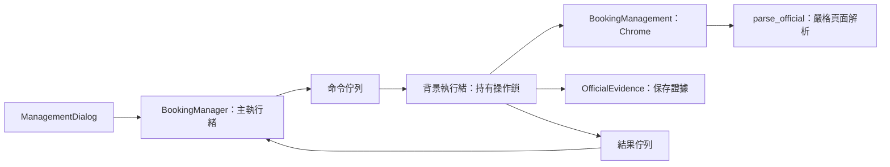

# 官網訂位核對與取消

2026-10-23 原始碼功能。入口為「我的訂位 → 官網核對／取消」。**此介接仍為實驗性：公開查詢表單已確認，登入後的真實明細與取消回應尚未取得實站驗收證據。** 合成頁面測試通過不代表所有現行官網頁面都能辨識；不符契約時程式停止並保留紀錄。

## 適用範圍

- 使用目前設定中保存的身分證字號、目前單筆訂位及八碼代碼查詢。身分證字號不放進工作日誌、報告或對話框。
- 查詢驗證碼由使用者在 App 內看圖輸入，支援換圖；沒有連續自動猜測或背景重查。
- 可保存已核對的未付款／已付款狀態；付款和取票均不由此功能執行。
- 程式取消只開放**未付款、單程、代碼與完整行程一致**的訂位。已付款退票、已取票、多人分別取消、來回票及不明格式不在支援範圍，請到官網處理。
- 尚未取得代碼時，不能只靠本機紀錄推斷官網結果。先經官網查詢代碼，再回到此處核對；查無資料、驗證碼錯誤或斷線都不能當成「沒有訂位」。

官方服務與操作入口以[高鐵網路訂票說明](https://www.thsrc.com.tw/ArticleContent/dea241a9-fe69-4e9d-b9a5-6caed6e486d6)為準。本程式採較小的取消支援範圍，不代表涵蓋官方所有退票方式。

## 查詢與同步

1. 儲存正確的取票識別碼，停止其他任務。
2. 在目前訂位卡片開啟「官網核對／取消」。已有代碼會帶入；待確認紀錄可自行填入官網查得的代碼。
3. 按「開始官網核對」。程式以獨立 Chrome 暫存工作階段開啟官網，不使用日常 Chrome 的登入資料。
4. 在 App 輸入圖片中的四碼英數字，按「查詢」。資料不符時請核對證號及代碼；換圖不等於修復錯誤身分資料。
5. 核對代碼、日期、起訖站與車次，以及官網回傳狀態。通過檢查後可按「同步核對結果」。

同步未付款／已付款結果時保留 `.state.json` 防重送狀態；原待確認狀態可更新為已訂位並保存代碼。同步已取消的明確結果時，原狀態會與核對證據一起封存。未知、逾時或查無資料均不解除阻擋。

新訂位會在送出前保存日期、起訖站與車次；取得結果後，先保存代碼與票券摘要，再輸出畫面或保存完整結果，縮小輸出失敗造成代碼遺失的窗口。較舊紀錄可能缺年份、起訖站或完整行程，因此能查詢狀態也未必能由程式取消；請走原有人工核對流程。

### 行程解析契約

目前只接受一筆行程列，依序為六個獨立儲存格：日期、起站、迄站、出發時間、抵達時間、車次。日期須為有效的 `20xx/MM/DD` 或 `20xx-MM-DD`，時間為有效 24 小時 `HH:MM`，車次為 1–9999。只有同一列各欄位都符合本機預期行程，才開放同步或準備取消；已知的抵達時間也要一致。

此處已修正從整頁尋找日期、在整列比對數字與時間造成的誤判。頁尾包含預期日期、日期的日數恰好等於車次、抵達時間等於預期出發時間，都不能成立核對。多段、合併欄、額外欄位或未知排版一律保留待確認，不能先猜測欄位順序以允許取消。

六欄契約目前由合成頁面驗證；尚未宣稱現行官網登入後一定採用此排版。2026-10-23 使用者回覆沒有測試資料，因此保留實驗性標示及實站驗收項目。

## 取消流程

1. 查詢得到未付款狀態，且只有一段符合預期日期、方向、車次與已知出發時間的行程。
2. 按「準備取消未付款訂位」。程式進入官網的「取消／修改訂位」管理頁，再次核對。
3. 閱讀結果，勾選「我已核對代碼與完整行程」，按「確認取消官網訂位」。確認有效時間為兩分鐘；過期須重新準備與核對。
4. 程式先將 `cancellation_pending` 寫入磁碟，再操作官網取消。無法保存此證據就不送出。
5. 只有回應明確包含相同代碼及已取消狀態時，才保存成功證據並封存原狀態。純關閉視窗或 HTTP 成功都不算取消成功。

開始送出後不重試 POST。逾時、斷線、網站拒絕、未知確認視窗或解析失敗，都保留防重送狀態及待核對證據。請結束工作階段後重新查詢；重新取得相同代碼的明確已取消結果，可再同步封存。程式不會根據上一輪錯誤自動再取消一次。

## 工作階段與介面

整個工作階段最多保留 15 分鐘。Chrome 與 Playwright 只由同一背景執行緒操作；等待使用者輸入時仍持有該設定的操作鎖，避免同時訂位、切換設定、整理或還原資料。

「停止並結束工作階段」會等待當前網頁操作結束，再關閉隔離瀏覽器；已送出的取消無法靠停止撤回。關閉 App 亦會等待工作執行緒結束。使用期間請不要同時在程式開啟的 Chrome 中修改頁面。

## 保存內容

| 位置 | 用途 |
| --- | --- |
| `<設定>.state.json` | 防重送狀態、已知代碼、可用的行程摘要與最後核對狀態。 |
| `<設定>.runs/official/<識別碼>.json` | 查詢及取消證據：固定狀態、時間、代碼與核對摘要。沒有證號、原始 HTML 或驗證碼。 |
| `<設定>.runs/archives/<識別碼>/state.json` | 取消已確認後保存的原始狀態位元組。 |
| 同目錄 `resolution.json` | `source: official_response` 的已取消核對紀錄。原有人工確認仍使用 `user_verified`。 |

這些證據含訂位代碼與行程，屬私人資料；完整備份會包含，永久查票日誌清理會保留。

## 程式閱讀路線



- `official_booking.py` 不依賴 Qt，負責結構化狀態、單一行程核對、狀態指紋及持久化。
- `remote/booking_management.py` 負責實際表單、圖片、精確按鈕及確認視窗；每次讀取都檢查官網來源，外站表單 action 會在送出前拒絕。
- `desktop/management.py` 負責命令、工作階段、確認期限、停止與執行緒結束；不讓 Playwright 物件跨執行緒使用。
- `ManagementDialog.qml` 負責展示與明確確認。checkbox 未勾選時不開放取消。

## 已驗證與未驗證

已完成合成 HTML、狀態變更、保存失敗、同意門檻、確認期限及取消逾時測試。另以**實際 headless Chrome、全請求攔截**測試查詢／換圖、原生確認視窗、兩階段取消、已付款阻擋、外站 action 阻擋及取消斷線不重送：

```powershell
.\.venv\windows\Scripts\python.exe -m scripts.verify_management_transport
```

尚未完成真實訂位的登入後明細／取消頁面契約比對、實站取消及斷線後回查驗收。驗收需要指定可測試的訂位與操作範圍，不能由工具自行選擇使用者既有票券。程式端的保護與實驗性標示會保留至取得證據。
