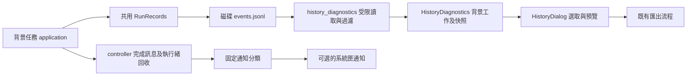

# 歷史任務診斷與桌面通知

2026-10-23 原始碼更新。這兩項功能尚未重新打包，現有 `TravelDesk-Setup-0.4.0.exe` 不包含它們。請從專案執行 `python -m thsr_ticket.desktop` 使用；不需修改個人訂票設定格式。

## 查看過去的任務

1. 在「設定 → 進階與關於」按「歷史任務診斷」。程式在背景讀取目前設定旁的執行紀錄，也包含已整理到歷史備份的紀錄。
2. 在左側選擇任務，右側顯示結果、最後階段、執行版本及下一步建議。日期是事件檔最後修改時間，以台灣時間顯示，不是乘車日期或精確啟動時間。
3. 按「預覽與匯出診斷」查看過濾後的 JSON，再按「確認匯出」，選擇新的 `*.diagnostics.json`。匯出的內容與預覽相同；不覆寫既有檔案。
4. 要更新內容，回到歷史列表按「重新讀取」。讀取中可取消；關閉 App 會取消並等待工作結束。

「本次診斷匯出」只包含本次開啟 App 後的事件及目前狀態；「歷史任務診斷」則讀取磁碟保存的個別任務，重開 App 後仍可使用。兩者都不需要開啟 Chrome 或連線官網。

## 內容與讀取限制

| 項目 | 行為 |
| --- | --- |
| 任務範圍 | 目前設定的 `*.runs/<UUID>/events.jsonl` 及 `*.runs.history-backups/<批次 UUID>/<UUID>/events.jsonl`，依修改時間選最近 200 次。不是其他設定的全域歷史。 |
| 單份大小 | 頭部最多 64 KiB 用於讀取執行環境；主體最多讀取末端 4 MiB，保留最後 200 筆允許事件。超過範圍、損壞或讀取期間變更時提示內容不完整。 |
| 執行環境 | 新紀錄保存 App／Python 版本、作業系統種類及是否只查票；舊紀錄缺少者標示未記錄，匯出為 `unknown` 或 `null`，不以目前環境冒充。 |
| 可匯出資料 | 固定事件名稱、階段、原因、結果、查詢輪數及合理範圍內的耗時。另有讀取警告與目前檢視程式版本。 |
| 不匯出資料 | 原始錯誤文字、完整日誌、證號、手機、訂位代碼、行程／車次、私人路徑及內部目錄識別碼。 |
| 讀取失敗 | 單筆無法讀取時保留其他結果並顯示失敗數；整個根目錄無法存取則顯示固定指引。連結與 junction 不追蹤。 |

歷史結果是唯讀的診斷快照，不能代表官網當下仍有票、已付款或已取消。未完整結束的紀錄可能仍在執行，也可能是意外中斷；送出訂位階段發生錯誤或保存失敗時，請先核對官網。重新讀取與匯出都不會解除防重送狀態。

## 開啟桌面通知

在「設定 → 一般偏好」開啟「啟用任務通知」。預設關閉，選項立即保存在 App 偏好，不需再按「儲存設定」。切換或另存行程設定不會清除這項偏好。開啟且系統支援時，可按「測試通知」：它不執行查票或訂位，點擊通知回到設定頁，也不影響正式任務的通知次數。

| 任務結果 | 通知及點擊目的地 |
| --- | --- |
| 自動訂位成功，狀態保存為已訂位 | 「訂位成功 · 尚未付款」，回到「我的訂位」。 |
| 已送出但結果或紀錄仍需核對 | 「訂位結果待確認」，回到「我的訂位」。 |
| 只查票成功 | 「查票完成」，回到「任務進度」；不受先前已訂位紀錄影響。 |
| 達查詢上限或執行失敗 | 固定結果提示，回到「任務進度」。 |
| 一般手動停止 | 不通知；若已涉及送出訂位而待核對，仍提示核對。 |

通知只使用固定文字，不包含行程、證號、電話或訂位代碼；不透過郵件或外部訊息服務發送。正常工作會在背景執行緒結束、完成清理並刷新防重送狀態後，只發一次；重開程式、查看歷史或封存紀錄不會重播通知。背景執行緒無法啟動時也會提示失敗。

啟用後可從系統匣圖示回到 App。通知／圖示點擊會開啟最近一次通知所對應的頁面；它不是可持續追蹤每筆訂位的通知中心。系統不支援通知時會顯示提示並保留偏好；Windows 勿擾或使用者系統設定可能隱藏訊息。關閉 App 會停止工作及移除系統匣圖示，沒有常駐背景模式，也不會由通知重新啟動已關閉的 App。

## 實作流程與責任

`application.run_background()` 在啟動檢查前建立一份 `RunRecords`，把同一物件交給 `AutomationRunner`，避免準備與查票分散成兩份日誌。瀏覽器啟動、OCR 載入及排程等待因此都能留下階段資訊。`run_started` 保存執行環境；`task_completed` 保存外層工作最後結果，核心 runner 的 `run_finished`／`run_stopped` 仍保留。CLI 直接使用 runner 時維持原有生命週期。資料整理也接受新的終止事件；仍必須通過版本、完整內容及防重送檢查。

`history_diagnostics.py` 不依賴 Qt，負責路徑範圍、大小限制、舊格式相容及允許清單。`desktop/history.py` 同時只啟動一個非 daemon 工作執行緒，重複請求只保留最新目標；generation 防止舊設定的結果覆蓋新畫面。工作完成透過 queue 回報，再由 controller 計時器更新 Qt 屬性。切換設定先清除舊選取，預覽複製已過濾快照，匯出時不再重新讀取原檔。

`desktop/tools.py` 接收 controller 的唯讀任務上下文，協調診斷、通知偏好、正式通知及測試通知；開發介面改由 `controller.tools` 呼叫。`desktop/notifications.py` 把結果判斷與系統匣介接分開，前者只產生固定字串與目的頁，後者負責系統可用性及使用者開關。只有正常 GUI 入口建立實際系統匣；自我檢查、假資料預覽及單元測試不建立真實通知工作流。測試以假的 tray 驗證呼叫，沒有發出作業系統通知，因此通知實際出現、點擊與視窗焦點仍需 Windows 人工驗收。畫面與工具服務的責任見 [介面分層](desktop-ui.md)。

測試入口：`unittest/test_history_diagnostics.py` 檢查資料遮蔽、大型／損壞內容、結果分類、取消及共用日誌；`unittest/test_desktop.py` 檢查非同步切換、凍結預覽匯出、關閉等待、偏好保存、通知一次性與 QML 顯示。
